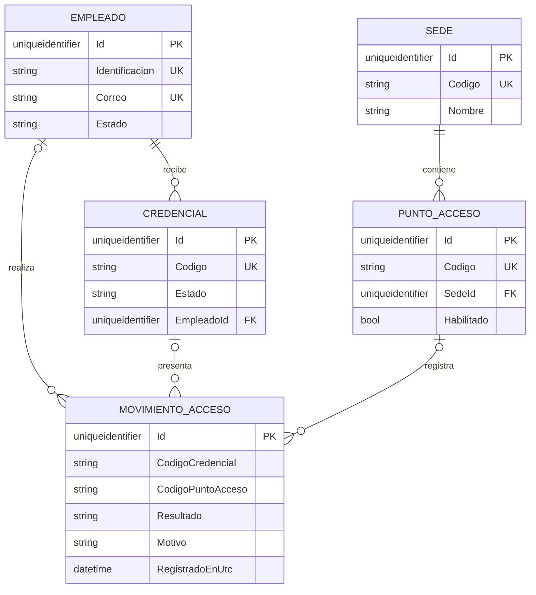
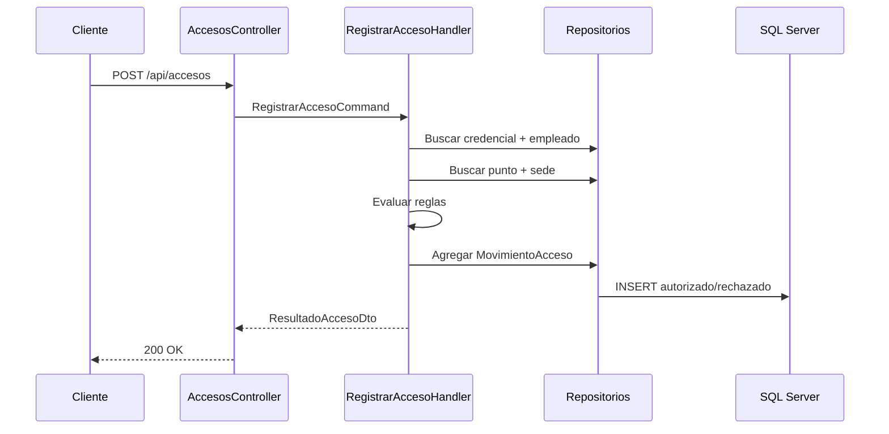

# Diseño técnico y dominio

## Contextos y agregados

El alcance se trata como un contexto delimitado de **Control de Accesos**. `Empleado`, `Credencial` y `PuntoAcceso` mantienen sus propias invariantes; `MovimientoAcceso` es el registro auditable e inmutable del resultado de una solicitud.

Las relaciones de movimiento son opcionales para poder auditar un código de credencial o punto inexistente sin violar una llave foránea.

## Flujo CQRS de acceso

La consulta de historial usa otro handler y una ruta de lectura independiente. No muta entidades y ejecuta `AsNoTracking()`.

## Matriz de validación de acceso

| Condición | Resultado |
|---|---|
| Credencial inexistente | Rechazado |
| Punto inexistente | Rechazado |
| Credencial bloqueada o revocada | Rechazado |
| Empleado inactivo | Rechazado |
| Punto deshabilitado | Rechazado |
| Todas las validaciones correctas | Autorizado |

Cada rama genera un `MovimientoAcceso` y guarda un motivo explícito.
